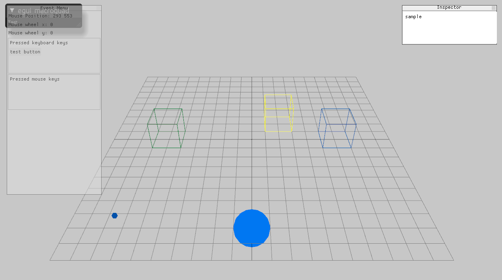
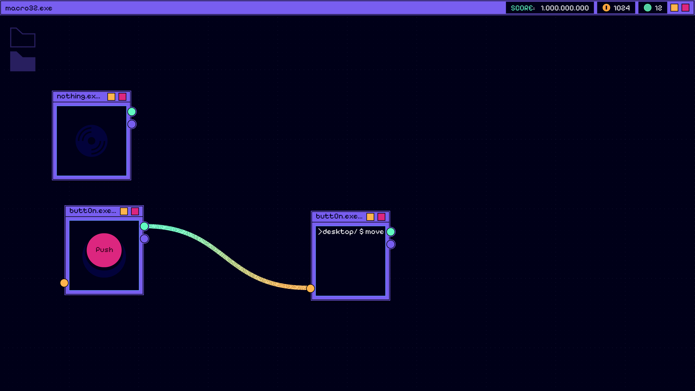
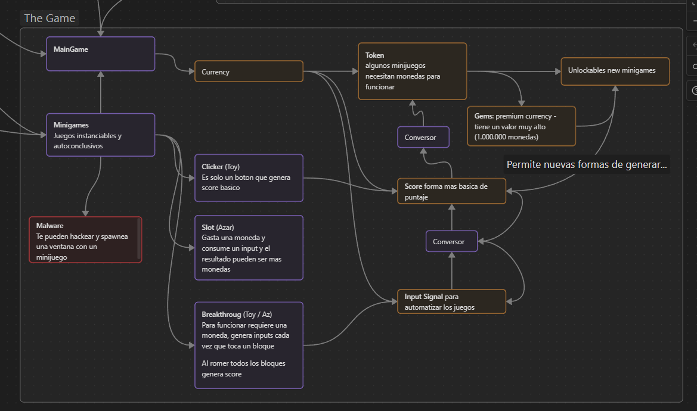

# Proyecto Rust Macroquad

En `Visual Studio Code` compilar con `Ctrl + Shift + B`, en terminal usar `cargo build` para compilar y `cargo run` para ejecutar.

## Objetivos 

Aprender y crear un juego en rust, aprender a utilizar el ecosistema y construir un playground/engine que facilite la creación de juegos en un motor de bajo nivel.

### Estrategia

Parte del desafío es armar múltiples minijuegos que funcionen independientemente, y en conjunto hagan un juego incremental.

Lo mas importante es **aprender** y compartir el **conocimento**

# El juego - Proyecto macroware32.exe



Proyecto `macroware32.exe` es fundamente un juego incremental que simula un entorno de escritorio tipo **windows 95** donde hay muchos **minijuegos arcades muy simples**  y algunos programas. 

El concepto central esta en que los juegos pueden conectarse con otros juegos por nodos (similar a un editor de shader visual), estos nodos pueden transfieren comandos de entrada (VirtualInputs) o Currency (Score, Token y Gems). y parte del loop incentiva al jugador a automatizar los procesos para generar mayor input

El objetivo del juego es conseguir el score mas grande y desbloquear  y completar proyectos.

los proyectos son minijuegos que consumen cantidades imposibles de recursos (gemas, tokens, inputs) y el premio es completarlos.
### Loop de juego



### Gestion del proyecto

- [Figma del proyecto](https://www.figma.com/design/LohWmjqQy6kBqVcYNpzOdb/RustMacroquadGame?node-id=4-2&t=YfUyBfRTBfSaeeAH-1)
- HackAndPlan
- Github
- Demo Page


| Web         |     |
| ----------- | --- |
| Demo Page   |     |
| HackAndPlan |     |
| Github      |     |


### Estética

Se busca un look retro pixelart con estilo similar a juegos de nitrome.
### Minijuegos

todo!()

### Referencias

| Juego          |     |
| -------------- | --- |
| Balatro        |     |
| Gamboranza     |     |
| Loop Hero      |     |
| Cookie clicker |     |


---
# Features & Sistemas
### Arquitectura de aplicación

### Dependencias

Listar las dependencias en `Cargo.toml` y su uso.

| Modulo                                                      | Descripcion              | Version |
| ----------------------------------------------------------- | ------------------------ | ------- |
| egui-macroquad                                              | Ui inmediata para editor | 0.17.3  |
| serde                                                       | para serializacion       |         |
| macroquad                                                   | el motor de entrada      | 0.4.1   |
| [num_bigint](https://docs.rs/num-bigint/latest/num_bigint/) | big number core          | 0.4.6   |

---
# Mas sobre Rust

| Title                    | Link                                                              |
| ------------------------ | ----------------------------------------------------------------- |
| Game dev Article         | https://loglog.games/blog/leaving-rust-gamedev/#positives-of-rust |
| Articles about macroquad | https://www.slowrush.dev/news/pixel-perfect-rendering/            |
| Macroquad book           | https://mq.agical.se/ch1-first-program.html                       |
| Macroquad examples       | https://github.com/not-fl3/macroquad/tree/master/examples         |
| Api docs                 | https://docs.rs/crate/macroquad/0.4.14                            |
| Rut by example           | https://doc.rust-lang.org/rust-by-example/custom_types.html       |
| Rust book                | https://doc.rust-lang.org/book/title-page.html                    |
| Rust Nomicon             | https://doc.rust-lang.org/nomicon/other-reprs.html                |
### Comandos

Compilar y ejecutar

```
cargo run
```

Compilar release optimizado

```
cargo build --release
```


Compilar API Docs

```
cargo doc --no-deps --open
```